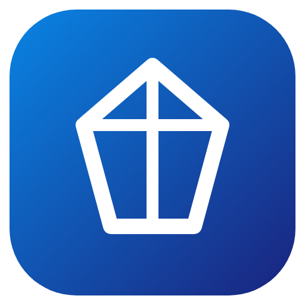

<h1 align="center">Theosis: Full Russian Localization</h1>

  Polished Russian localization package for Theosis RPG plugin v1.4 (default locale, full perk strings, rarities, names). 
  Полный пакет русской локализации для RPG плагина Theosis v1.4 (русский язык по умолчанию, перки, редкости, имена).

  
  
  

  <a href="#english">English</a> | <a href="#русский">Русский</a>

---

## English

### Overview

This repository provides clean, standalone Russian localization files for **Theosis v1.4**.
It contains only configuration and text files to respect original author licensing and copyright requirements.

### Files

- `config.yml`: Set to `ru_ru`.
- `lang/ru_ru.yml`: 2,357 keys.
- `rarities.yml`, `names.yml`.

### Installation

1. Copy files into `plugins/Theosis/`.
2. Or download pre-built `.jar` from [Releases](https://github.com/milkycloud-dev/theosis-full-russian-localization/releases/latest).

### Releases

Pre-built ready-to-use binaries (`.jar` / `.zip`) are available for download in [Releases](https://github.com/milkycloud-dev/theosis-full-russian-localization/releases/latest).

### License

MIT License. Created by milkycloud-dev (2026).

---

## Русский

### Описание

Репозиторий содержит чистые файлы русской локализации для **Theosis v1.4**.
В состав включены исключительно файлы конфигурации и переводов, без бинарных сборок, с соблюдением требований лицензий авторов.

### Файлы

- `config.yml`: Русский по умолчанию (`ru_ru`).
- `lang/ru_ru.yml`: 2357 ключей.
- `rarities.yml`, `names.yml`.

### Установка

1. Скопируйте файлы в папку `plugins/Theosis/`.
2. Либо скачайте готовую сборку `.jar` из раздела [Releases](https://github.com/milkycloud-dev/theosis-full-russian-localization/releases/latest).

### Релизы

Готовые собранные бинарные пакеты (`.jar` / `.zip`) доступны для загрузки в разделе [Releases](https://github.com/milkycloud-dev/theosis-full-russian-localization/releases/latest).

### Лицензия

MIT License. Создано milkycloud-dev (2026).
