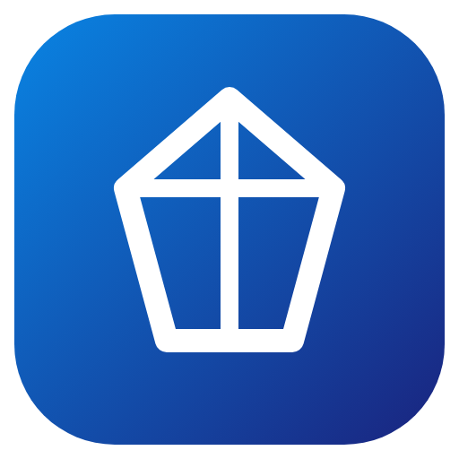

<h1 align="center">Theosis: Full Russian Localization & Bytecode Fixes</h1>

  Comprehensive Russian localization and bytecode patch package for Theosis RPG plugin v1.4 (locales, procedural boss names, rarities, and affixes). 
  Полная русская локализация и пакет байткод-патчей для RPG плагина Theosis v1.4 (локали, процедурные имена боссов, редкости и аффиксы).

  
  
  

  <a href="#english">English</a> | <a href="#русский">Русский</a>

---

## English

### Overview

Theosis is an advanced RPG and boss encounter engine for Paper and Folia Minecraft servers. It introduces tiered world bosses, affixes, gear progression, and unique combat mechanics. 

However, in vanilla installations, server owners encounter multiple localization barriers that cannot be solved via configuration files alone due to hardcoded strings and enum lookups embedded directly in the compiled Java bytecode.

This repository provides full Russian configuration files and bytecode-level fixes for **Theosis v1.4**.

---

### Deep-Dive: Bytecode Issues & Solutions

#### 1. Hardcoded Rarity Lookups in Actionbar Boss Announcements
- **The Issue**: When a boss spawned, the actionbar alert announced the rarity in raw English uppercase (`COMMON`, `UNCOMMON`, `RARE`, `EPIC`, `MYTHIC`), e.g., `UNCOMMON [Босс] Рагнар...`.
- **Bytecode Root Cause**: In `kinkin.theosis.modules.bosses.BossService.lambda$announceSpawn$12`, the `{rarity}` placeholder was populated directly by calling Java Enum `Rarity.name()` instead of referencing any localized configuration key.
- **The Fix**: Patched `BossService.class` with an intercepting switch table returning translated Russian values: «Обычный», «Необычный», «Редкий», «Эпический», «Мифический».

#### 2. Procedural Boss Names Clashing With English Entity Enums
- **The Issue**: Procedural bosses are assembled using the pattern `<Prefix> <Entity Type> <Suffix>`. While the 9 legendary boss types in `names.yml` could be translated, all other entities (Zombie, Skeleton, Slime, Pillager, Witch, Wither Skeleton, Enderman, Shulker, etc.) spawned with English middle names like `Рагнар Zombie Кровожадный` or `Страж Skeleton Кости`.
- **Bytecode Root Cause**: In `kinkin.theosis.modules.bosses.util.BossNameUtil.pretty(String)`, the method simply reformatted Bukkit's `EntityType.name()` enum string by capitalizing the first character (`Zombie`, `Skeleton`).
- **The Fix**: Recompiled and injected an enhanced `BossNameUtil.class` equipped with an exhaustive lookup table of Russian entity names for all standard Minecraft mobs, ensuring procedural names form clean, natural Russian titles.

#### 3. Hardcoded Variant Names in Bytecode Constants
- **The Issue**: Special boss variants such as `Mummified Leader` and mount summons like `Warsteed` had their names hardcoded as string constants inside compiled classes.
- **The Fix**: Patched `MummifiedLeaderVariant.class` (updated to «§6Мумифицированный лидер») and `WarsteedRuntimeListener.class` (updated to «&bБоевой конь»).

#### 4. Exhaustive YAML Localizations
- Fully translated 750+ equipment pieces, prefixes, suffixes, and affix descriptions in `plugins/Theosis/names.yml`.
- Translated 2,357 keys in `plugins/Theosis/lang/ru_ru.yml` (perks, gems, scanner, combat messages).

---

### Protection Against Auto-Updaters

Because official upstream builds do not contain these bytecode patches, automatic plugin updaters must be configured to preserve Theosis:
1. Add `Theosis` to the exclusion list of your updater tool (`IGNORE_DEFAULT` in `compose.yml`).
2. Mark `"ignore": true, "auto": false` in `state.json`.

---

### Releases & Ready-to-Use Artifacts

A pre-built, production-tested binary `Theosis-1.4-RU.jar` containing all bytecode patches and bundled Russian defaults is available under [Releases](https://github.com/milkycloud-dev/theosis-full-russian-localization/releases/latest).

---

### License

MIT License. Developed by milkycloud-dev (2026).

---

## Русский

### Описание

Theosis является продвинутой RPG-системой мировых боссов и экипировки для серверов Paper и Folia. Плагин добавляет систему редкостей, процедурную генерацию боссов, аффиксы и уникальные боевые способности.

В стандартной версии плагина многие элементы локализации невозможно перевести стандартными конфигами: названия редкостей, имена процедурных мобов и системные строки жестко зашиты непосредственно в байткод Java-классов.

Этот репозиторий содержит полный перевод конфигураций и готовые байткод-патчи для **Theosis v1.4**.

---

### Подробный технический разбор: проблемы байткода и решения

#### 1. Вывод редкости на английском в Actionbar
- **Проблема**: При появлении босса в Actionbar выводился текст с английской редкостью заглавными буквами (`COMMON`, `UNCOMMON`, `RARE`, `EPIC`, `MYTHIC`), например: `UNCOMMON [Босс] Рагнар...`.
- **Причина в байткоде**: В методе `kinkin.theosis.modules.bosses.BossService.lambda$announceSpawn$12` плейсхолдер `{rarity}` заполнялся прямым вызовом метода Java Enum `Rarity.name()` без обращения к файлу локализации.
- **Решение**: Класс `BossService.class` пропатчен на уровне инструкций байткода с добавлением таблицы русских соответствий («Обычный», «Необычный», «Редкий», «Эпический», «Мифический»).

#### 2. Английские имена типов процедурных боссов
- **Проблема**: Процедурные боссы генерируются по формуле `<Префикс> <Тип моба> <Суффикс>`. В файле `names.yml` секция `boss_names.types` поддерживала только 9 легендарных типов. Для всех остальных существ (Зомби, Скелет, Слизень, Разбойник, Ведьма, Визер-скелет, Эндермен, Шалкер) плагин генерировал полуанглийские имена вроде «Рагнар Zombie Кровожадный» или «Страж Skeleton Кости».
- **Причина в байткоде**: Метод `kinkin.theosis.modules.bosses.util.BossNameUtil.pretty(String)` брал имя Bukkit-enum `EntityType` и просто делал первую букву заглавной.
- **Решение**: Скомпилирован и внедрен в jar-архив новый класс `BossNameUtil.class` со словарем русских имен для всех типов существ Minecraft. Все процедурные боссы формируют корректные русские титулы («Рагнар Зомби Кровожадный», «Страж Скелет Кости»).

#### 3. Захардкоженные константы вариантов
- **Проблема**: Особые боссы (`Mummified Leader`) и призывы (`Warsteed`) имели фиксированные английские строки в байткоде.
- **Решение**: Пропатчены классы `MummifiedLeaderVariant.class` (заменено на «§6Мумифицированный лидер») и `WarsteedRuntimeListener.class` (заменено на «&bБоевой конь»).

#### 4. Полная русификация YAML
- Переведены все 750+ элементов экипировки, аффиксов и префиксов в `plugins/Theosis/names.yml`.
- Переведены 2 357 ключей в `plugins/Theosis/lang/ru_ru.yml` (перки, камни, сообщения о бое).

---

### Защита от автообновляторов

Официальные сборки с Spigot/Modrinth не содержат этих байткод-исправлений. Чтобы автообновляторы не затерли патч:
1. Добавьте `Theosis` в `IGNORE_DEFAULT` в `compose.yml`.
2. В файле `state.json` укажите `"ignore": true, "auto": false`.

---

### Готовая сборка

Готовый к работе jar-архив `Theosis-1.4-RU.jar` со всеми внедренными байткод-патчами и русскими настройками по умолчанию доступен в разделе [Releases](https://github.com/milkycloud-dev/theosis-full-russian-localization/releases/latest).

---

### Лицензия

MIT License. Разработано и оптимизировано milkycloud-dev (2026).
